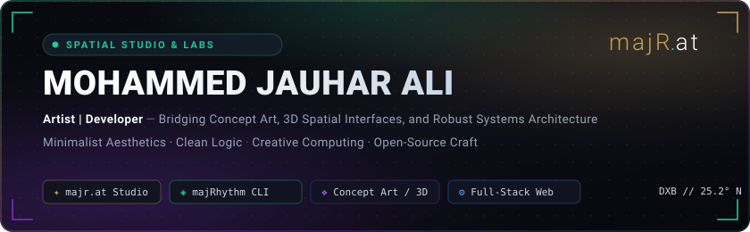

<div align="center">

  <!-- Bespoke Spatial Studio SVG Banner -->
  

  <br/><br/>

  <!-- Quick Connect Bar -->
  <a href="https://majr.at" target="_blank">
    
  </a>
  <a href="https://portfolio.majr.at" target="_blank">
    
  </a>
  <a href="https://www.artstation.com/majrat" target="_blank">
    
  </a>
  <a href="https://www.linkedin.com/in/majrat/" target="_blank">
    
  </a>
  <a href="mailto:mjjauharali@gmail.com">
    
  </a>

</div>

<br/>

### ✦ Philosophy & Overview

I am **Mohammed Jauhar Ali** (`majrat`), a versatile **Artist & Developer** operating at the confluence of digital art, spatial design, and software engineering. My work bridges concept art, 3D spatial environments, interactive web architectures, and focused command-line tools.

- 🌌 **Spatial Studio**: Founder of [majR.at](https://majr.at), crafting spatial digital portals, interactive web geometry, and minimalist tools.
- 🎨 **Visual & Concept Art**: Environmental design, digital painting, and 3D sculpting on [ArtStation](https://www.artstation.com/majrat).
- ⚡ **Engineering**: Full-stack web apps (Next.js, TypeScript, React), real-time streaming services, and zero-scroll terminal tools.
- 📍 **Location**: Asia / Dubai (collaborating globally).

---

### ◈ Spatial Portals & Active Systems

A curated directory of live portals, tools, and platforms developed under the **majR.at** ecosystem:

<table>
  <thead>
    <tr>
      <th align="left">Portal / Project</th>
      <th align="left">Type &amp; Domain</th>
      <th align="left">Core Stack</th>
      <th align="left">Description &amp; Access</th>
    </tr>
  </thead>
  <tbody>
    <tr>
      <td><b><a href="https://github.com/majrat/majRhythm">majRhythm</a></b></td>
      <td><code>CLI Audio Engine</code></td>
      <td><code>Python</code> <code>Curses</code> <code>mpv</code> <code>yt-dlp</code></td>
      <td>A gorgeous, full-screen terminal music player with an in-place zero-scroll UI streaming audio from the command line.<br/>👉 <a href="https://github.com/majrat/majRhythm">View Repository</a></td>
    </tr>
    <tr>
      <td><b><a href="https://shop.majr.at">Shop Portal</a></b></td>
      <td><code>Spatial E-Commerce</code></td>
      <td><code>React</code> <code>Zustand</code> <code>Supabase</code> <code>Docker</code></td>
      <td>Spatial boutique retail featuring 3D product preview geometry, variant configurators, and cloud wishlist sync.<br/>👉 <a href="https://shop.majr.at">Visit Storefront</a></td>
    </tr>
    <tr>
      <td><b><a href="https://rethink.majr.at">reThink</a></b></td>
      <td><code>Logic Engine</code></td>
      <td><code>React Native</code> <code>Expo</code> <code>Zustand</code></td>
      <td>Digital thought construction portal. Translates logical syntax trees, local pipeline loops, and dynamic workflows.<br/>👉 <a href="https://rethink.majr.at">Launch Core</a></td>
    </tr>
    <tr>
      <td><b><a href="https://github.com/majrat/agent-portal">Agent Portal</a></b></td>
      <td><code>Web Platform</code></td>
      <td><code>Next.js</code> <code>TypeScript</code> <code>Tailwind</code></td>
      <td>Full-stack administrative platform with responsive architecture, fluid dashboard UI, and modern API workflows.<br/>👉 <a href="https://agent-portal-wn8z.vercel.app/">Live Preview</a> • <a href="https://github.com/majrat/agent-portal">Repository</a></td>
    </tr>
    <tr>
      <td><b><a href="https://www.artstation.com/majrat">Concept Art Lab</a></b></td>
      <td><code>Visual Art &amp; 3D</code></td>
      <td><code>Blender</code> <code>Krita</code> <code>Figma</code></td>
      <td>Portfolio of freelance concept design, environment worldbuilding, character visualization, and asset sculpting.<br/>👉 <a href="https://www.artstation.com/majrat">Explore ArtStation</a></td>
    </tr>
    <tr>
      <td><b><a href="https://github.com/majrat/HLS-Video-Streaming-Backend-Service">HLS Streaming</a></b></td>
      <td><code>Media Infrastructure</code></td>
      <td><code>TypeScript</code> <code>Node.js</code> <code>AWS S3</code></td>
      <td>Adaptive multi-bitrate HLS video transcoding and streaming backend service built for high-throughput distribution.<br/>👉 <a href="https://github.com/majrat/HLS-Video-Streaming-Backend-Service">View Repository</a></td>
    </tr>
    <tr>
      <td><b><a href="https://blog.majr.at">Journal &amp; Manifestos</a></b></td>
      <td><code>Technical Journal</code></td>
      <td><code>Beehiiv</code> <code>Markdown</code> <code>Curation</code></td>
      <td>Curated essays exploring spatial design patterns, system architectures, and creative computing breakthroughs.<br/>👉 <a href="https://blog.majr.at">Read Articles</a></td>
    </tr>
  </tbody>
</table>

---

### ⚙ Tech Stack & Creative Arsenal

```
Spatial & Concept Art    ───►  Blender · Three.js · Figma · Godot Engine · Krita
Frontend Architecture    ───►  Next.js · React · TypeScript · Zustand · TailwindCSS
Backend & Cloud Systems  ───►  Node.js · Express · Supabase · PostgreSQL · Docker · AWS
Systems & Development    ───►  Python · Linux · Neovim (LazyVim) · Curses · Git · Bash
```

<br/>

<details open>
<summary><b>Detailed Tooling &amp; Frameworks</b></summary>
<br/>

**Spatial & Creative Suite**  


**Frontend & Spatial UI**  


**Backend, Database & Cloud**  


**Systems, CLI & Workflow**  


</details>

---

### 📊 GitHub Activity & Metrics

<div align="center">
  
  &nbsp;
  
</div>

<br/>

<div align="center">
  <sub><i>"Translating logical syntax trees into elegant visual geometry."</i> — <b><a href="https://majr.at">majR.at</a></b></sub>
</div>

---

### 🌐 Colophon & Studio Directory

<div align="center">

| Channel | Destination | Focus |
| :--- | :--- | :--- |
| **Studio Portal** | [majr.at](https://majr.at) | Spatial design showcase, digital boutique & portals |
| **Interactive Portfolio** | [portfolio.majr.at](https://portfolio.majr.at) | Engineering case studies & software portfolio |
| **ArtStation** | [artstation.com/majrat](https://www.artstation.com/majrat) | Concept art, environment design & 3D sculpting |
| **LinkedIn** | [linkedin.com/in/majrat](https://www.linkedin.com/in/majrat/) | Professional network & experience |
| **YouTube** | [youtube.com/@majRFan](https://www.youtube.com/@majRFan) | Creative work, breakdowns & streams |
| **Instagram** | [instagram.com/ma.jr.at](https://www.instagram.com/ma.jr.at/) | Visual art, work-in-progress & sketches |
| **Email** | [mjjauharali@gmail.com](mailto:mjjauharali@gmail.com) | Collaboration inquiries & direct contact |

<br/>

```
majR.at Studio  •  Minimalist Aesthetics  •  Clean Logic  •  Modern Architecture
```

</div>
